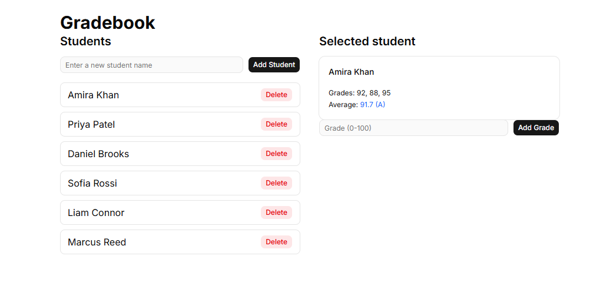

# Gradebook API

[](https://github.com/anilaasher/gradebook-api/actions/workflows/tests.yml)

A web API for managing students and their grades, built with Python, FastAPI and SQLite, with a React front end.





## Run the API

```
python -m pip install -r requirements.txt
python -m uvicorn app:app --reload
```
## Run with Docker

```
docker compose up --build
```

The API is then available at http://localhost:8000/docs. The database is kept in a Docker volume, so the data survives restarts.

## Run the tests

```
python -m pip install -r requirements-dev.txt
python -m pytest -v
```

## Endpoints

| Method | Path | What it does |
|--------|------|--------------|
| POST | /students | Add a student (JSON body with `name`) |
| GET | /students | List all student names |
| GET | /students/{name} | Get one student's grades and average |
| POST | /students/{name}/grades | Add a grade (JSON body with `score`) |
| DELETE | /students/{name} | Delete a student and their grades |

With the API running, interactive documentation is at http://127.0.0.1:8000/docs

## What I learned

- **Testing:** Tests use a completely different database file (`test.db`), so the real database is never touched at all. The setup creates empty tables, and each test then adds whatever data it needs itself. The tables are created before each test and dropped after it, which is why one test can never affect another.
- **Automation:** Each time we push code to GitHub, pytest runs to check for problems. The tests run on a fresh computer in the cloud, and the result shows as a green tick or red cross.
- **Modern front end:** Tailwind gives you small ready-made styling words, and shadcn/ui gives you ready-made components (like Button and Card). shadcn copies the component code into your project, so you own it.
- **Working habits:** `requirements.txt` is the list of dependencies that the Gradebook API needs, and pip reads it when the project is installed on a new computer. `COMMANDS.md` is a cheat sheet of the commands for running the API server and React, and for installing the Python and React packages.